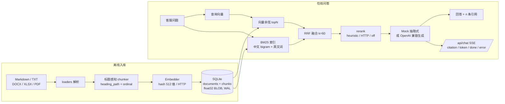

# 物流企业知识库智能问答服务（RAG）

面向物流售后与客服场景的内部知识库问答后端。客服输入自然语言问题，服务从内部政策、
运费时效、理赔流程等文档中检索依据，返回带 `[n]` 引用的中文回答；依据不足时明确拒答，
不编造赔付比例和时效。

这是一个个人项目。作者此前主要做 PHP 后端，借这个项目完整练习一套可部署、可评测、
可离线复现的 RAG 服务，而不是只停留在调用大模型 API 的 demo。

- **默认可离线运行**：`LLM_PROVIDER=mock`、`EMBED_PROVIDER=hash`，无需网络和 API Key。
- **核心逻辑零第三方依赖**：检索、分块、SQLite、BM25、评测全部使用 Python 标准库。
- **可选接入真实模型**：DeepSeek / Qwen 等 OpenAI 兼容接口，通过环境变量切换。
- **引用可审计**：回答标注文件名与章节路径，检索结果带各通道得分构成。

## 项目背景

物流公司的售后规则分散在售后政策、运费说明、理赔流程和 FAQ 中。客服遇到问题时需要
同时翻多份文档，常见痛点是：

1. 退款到账、退货验收、理赔材料等时效数字多，人工记忆容易出错；
2. 破损理赔涉及责任划分、材料清单、赔付比例，跨章节信息难快速拼齐；
3. 大模型直接回答容易编造政策，必须能回到原文并给出处；
4. 内部文档会更新，重复全量重建索引成本高，需要增量入库。

项目用「标题感知分块 + 向量/BM25 混合检索 + 引用约束生成」解决上述问题，并把评测
脚本、样例语料和报告一起放进仓库，保证结论可复现。

## 功能特性

| 能力 | 说明 |
| --- | --- |
| 多格式入库 | Markdown、TXT；DOCX/XLSX/PDF 为可选依赖，缺失时跳过并提示 |
| 标题感知分块 | 维护 `heading_path`，如 `售后与退货政策 > 退货时效 > 退款到账时效` |
| 增量入库 | SHA-256 文件内容哈希；未变跳过、变更覆盖，重复执行幂等 |
| 向量检索 | 默认 512 维确定性哈希向量；可切 OpenAI 兼容 `/embeddings` |
| BM25 | 纯标准库实现，中文 char bigram + 英文词，k1/b 可调 |
| 混合召回 | 向量 topN + BM25 topN，RRF（k=60）融合，保留 explain |
| 重排 | 启发式：章节标题命中、词覆盖、长度惩罚；可切 HTTP rerank |
| 回答生成 | 默认抽取式 mock；可切 OpenAI 兼容 chat completions，SSE 流式 |
| 引用与拒答 | 回答强制带 `[n]`；无依据时输出拒答模板 |
| 评测 | Recall@k、MRR、引用命中率、拒答准确率、关键点覆盖，自动写 Markdown |
| HTTP API | FastAPI 可选依赖：入库、检索、SSE 对话、统计、健康检查 |
| 工程化 | 结构化 JSON 日志、SQLite WAL、参数化 SQL、超时/重试、SSE 错误事件 |

## 架构



检索默认返回 5 条。每条命中在 `explain` 中保留向量排名与余弦分、BM25 排名与分数、
RRF 原始分、重排分、章节命中率和词覆盖率，便于解释「为什么是它」。

## 快速开始

要求 Python 3.11+。以下命令在项目根目录执行。

### 1. 零依赖演示（推荐先跑）

```powershell
cd repos\logistics-kb-rag
python -m app.demo
```

演示会自动创建 `data/demo.sqlite3`，完成：

1. 首次入库 4 篇示例文档；
2. 再入库一次，验证文件哈希幂等；
3. 打印文档/分块/向量维度；
4. 回答 3 个问题，其中 1 个是知识库没有答案的问题；
5. 每条回答带 `[1] 文件名 §章节` 引用，并打印检索 explain。

全程不需要 pip install、网络或 API Key。

### 2. 测试与评测

```powershell
python -m unittest discover -s tests -v
python -m app.cli eval
```

- 测试使用 `unittest`，不依赖 pytest 专有语法。零依赖环境会跳过 5 个 FastAPI 用例；
  安装 `requirements.txt` 后这 5 个用例会执行（另有 1 个「缺少 python-docx 时的提示」用例
  会自动跳过）。
- `eval` 默认读取 `data/gold_set.jsonl`；若数据库为空，会先入库 `data/sample_docs/`，
  再把真实指标写入 `docs/EVAL_REPORT.md`。

### 3. 安装完整栈并启动 HTTP 服务

```powershell
python -m venv .venv
.\.venv\Scripts\Activate.ps1
python -m pip install -r requirements.txt

python -m app.cli ingest data/sample_docs
python -m uvicorn app.api.app:create_app --factory --host 127.0.0.1 --port 8000
```

如果 PowerShell 禁止激活脚本，直接使用 `.\.venv\Scripts\python.exe -m ...`。

```powershell
curl.exe http://127.0.0.1:8000/healthz
curl.exe "http://127.0.0.1:8000/api/search?q=退款多久到账&top_k=3"

# PowerShell 下用 Python 发送 JSON，避免 curl.exe 的原生引号转义问题
python -c "import httpx; r=httpx.post('http://127.0.0.1:8000/api/chat', json={'question':'破损理赔需要哪些材料？'}); print(r.text)"
```

主要接口：

| 方法 | 路径 | 说明 |
| --- | --- | --- |
| GET | `/healthz` | 健康检查、文档/分块数 |
| POST | `/api/ingest` | 入库服务器可访问的目录，body `{"path": "..."}` |
| GET | `/api/search` | 检索，参数 `q`、`top_k`、`source` |
| POST | `/api/chat` | SSE 流式回答，事件 `citation` / `token` / `done` / `error` |
| GET | `/api/stats` | 语料统计、配置摘要、最近查询 |

FastAPI 是可选依赖。未安装时导入 `app.api.app` 不会崩溃，调用 `create_app()` 会给出
明确的安装提示；核心 CLI、demo 和测试不受影响。

### 4. Docker

```powershell
docker compose up --build
```

默认只启动 app 服务，SQLite 数据放在命名卷 `kb_data`。`docker-compose.yml` 内附了
pgvector 迁移方向的注释，但当前代码并未实现 Postgres 存储。

### 5. 切换到真实模型

复制 `.env.example` 为 `.env`（程序不会自动加载 `.env`，请按运行环境注入变量），
或直接在 shell 中设置：

```powershell
$env:LLM_PROVIDER="http"
$env:LLM_API_BASE="https://api.deepseek.com/v1"
$env:LLM_API_KEY="..."
$env:LLM_MODEL="deepseek-chat"

$env:EMBED_PROVIDER="http"
$env:EMBED_API_BASE="https://dashscope.aliyuncs.com/compatible-mode/v1"
$env:EMBED_API_KEY="..."
$env:EMBED_MODEL="text-embedding-v4"
```

注意：切换 embedding 模型或维度后，必须用新库重新入库；旧向量会因维度不一致被拒绝。
真实模型路径的代码已实现超时、有限重试、上下文预算和 SSE 解析，但仓库的自动化评测
默认只使用离线模式，避免测试依赖外部服务。

## 目录结构

```text
logistics-kb-rag/
├── README.md
├── LICENSE
├── .gitignore
├── .env.example
├── requirements.txt
├── pyproject.toml
├── Dockerfile
├── docker-compose.yml
├── Makefile
├── app/
│   ├── __init__.py          版本与 UTF-8 控制台
│   ├── config.py            基于环境变量的 dataclass 配置校验
│   ├── models.py            Document / Chunk / SearchHit / Citation / Answer
│   ├── errors.py            分阶段异常类型
│   ├── logging_utils.py     单行 JSON 结构化日志
│   ├── loaders.py           MD/TXT + 可选 DOCX/XLSX/PDF
│   ├── chunker.py           标题路径感知分块与滑窗
│   ├── embed.py             HashEmbedder / HttpEmbedder
│   ├── store.py             SQLite schema、float32 BLOB、余弦检索
│   ├── bm25.py              纯标准库 BM25
│   ├── retriever.py         混合检索、RRF、启发式/HTTP 重排
│   ├── generator.py         Mock 抽取式 / HTTP SSE 生成
│   ├── service.py           入库、检索、回答编排与 QueryLog
│   ├── eval.py              gold set 指标与报告
│   ├── cli.py               demo/ingest/search/ask/eval/stats
│   ├── demo.py              离线端到端演示
│   └── api/
│       ├── app.py           FastAPI factory + lifespan + CORS
│       ├── routes.py        REST 与 SSE 路由
│       └── schemas.py       pydantic 请求/响应模型
├── data/
│   ├── sample_docs/         4 篇中文物流业务文档
│   └── gold_set.jsonl       20 条评测样本（17 可回答 + 3 应拒答）
├── tests/                   76 个 unittest 用例
└── docs/
    ├── DESIGN.md            技术决策与取舍
    └── EVAL_REPORT.md       由 eval 实际生成
```

## 评测结果

评测命令：`python -m app.cli eval`。完整报告见 [`docs/EVAL_REPORT.md`](docs/EVAL_REPORT.md)。
以下数字为 2026-10-27 在本机真实运行结果，不是估算值：

| 指标 | 结果 | 说明 |
| --- | ---: | --- |
| Recall@1 | 70.6% | 期望来源排在第一位 |
| Recall@3 | 100.0% | 期望来源进入前 3 |
| Recall@5 | 100.0% | 期望来源进入前 5 |
| MRR | 0.8529 | 首个正确来源排名倒数的均值 |
| 引用命中率 | 88.2% | 回答引用中含期望来源，15/17 |
| 拒答判断准确率 | 100.0% | 17 题正常回答 + 3 题全部拒答 |
| 关键点覆盖率 | 98.0% | 期望关键点内容词覆盖 |
| 平均延迟 | 18.6 ms | 单题检索 + mock 生成，本机进程内 |

适用边界必须说清楚：**这是 4 篇文档、49 个分块、20 条自建 gold set 上的结果**。
它证明流程、引用和拒答逻辑可复现，不代表真实企业语料上的生产效果。未命中的 2 条
引用都来自同一类问题：FAQ 与正式政策内容重叠，检索优先引用 FAQ，而 gold set 标注
正式政策文件；这是「单一 expected_source」评测口径的局限，也说明真实场景需要允许多个
等价来源。

## 设计取舍摘要

### 为什么按标题分块，而不是定长切分

物流政策大量使用 `## 退货时效`、`### 退款到账时效` 这类层级。定长切分会把下一节
标题和上一节正文拼在一起，引用时只能给出文件名，无法定位章节。分块器保留
`heading_path` 与文档内 `ordinal`，引用展示为 `文件名 §章节路径`。超长段落再按中文
句末标点滑窗切分，窗口 650 字、重叠 120 字，避免语义从句中截断。

### 为什么向量 + BM25，而不是只用向量

客服问题里经常出现精确数字和专有词（`6000`、`1000 元`、`48 小时`、`70%`）。
哈希向量能补语义近似，但对数字和否定词不敏感；BM25 对精确词项更可靠。两路各取
`candidate_k` 个候选，再用 RRF 融合。

### 为什么用 RRF，而不是分数加权和

余弦相似度在 `[-1, 1]`，BM25 分数上限随语料变化，两者没有共同量纲。直接加权需要
不断调权重，换语料后又要重调。RRF 只使用排名：

```text
score(d) = Σ_channel 1 / (k + rank_channel(d)),  k = 60
```

它对分数分布不敏感，实现简单，适合这种两路召回规模不大的内部知识库。重排是之后的
独立业务校正：章节标题命中 25%、词覆盖 50%、文档标题 15%、长度合适度 10%；最终分
保留 45% 归一化 RRF、55% 重排分，并在 `explain` 中拆开显示。

### 为什么默认用哈希向量和抽取式回答

测试和 demo 的价值在于可重复。哈希向量和 mock 生成器完全确定性，不依赖网络、密钥、
模型版本和随机温度，CI 与本地结果一致。真实模型用同一套 `Embedder` / `Generator`
协议接入，不改变检索与引用链路。

### 拒答是怎么做的

只依赖生成提示词不够。服务在生成前做词面证据门槛：问题实词在前三条命中中的最高覆盖率
低于 28%，或匹配实词少于 2 个且问题不是极短查询，就直接走拒答模板。这样即使哈希向量
因碰撞召回了无关片段，也不会强行回答。真实模型提示词还要求资料不足时只输出
`NO_ANSWER`。

### 增量入库与幂等

每个文件先算 SHA-256，与 `documents.content_hash` 比较：相同则跳过；不同则在同一事务
内删除旧文档（级联删除分块）再写入新内容。重复执行 `ingest` 是幂等的，单个文件失败
不会中断整批任务。向量使用 float32 小端 BLOB 存储，SQLite 开启 WAL，每次操作使用
独立连接，避免 FastAPI 多线程共享连接。

更完整的决策记录见 [`docs/DESIGN.md`](docs/DESIGN.md)。

## 已知限制

1. **语料规模很小**：仓库只有 4 篇文档、49 个分块。评测数字只适用于这套样例，不能
   据此推断生产环境的召回率和延迟；接入真实语料后需要重新标注 gold set。
2. **哈希 embedding 只用于离线回归**：它基于字符 bigram 哈希，不理解同义改写，也
   不擅长跨语言语义。真实效果需要换成 bge-m3、text-embedding-v3/v4 等模型，并重新
   入库。
3. **没有多轮指代消解**：`/api/chat` 会接收历史并传给 HTTP 生成器，但检索查询仍是
   当前问题原文，没有做「它 / 这个费用」之类的 query rewrite；mock 生成器完全忽略历史。
4. **表格类 PDF 解析质量一般**：pypdf 只抽取文本层，扫描件没有 OCR；复杂跨页表格
   会丢列关系。DOCX/XLSX 只做基础段落、行文本转换，不保留样式和合并单元格语义。
5. **SQLite 向量检索是全量线性扫描**：万级分块以内可接受，规模继续增长应迁移到
   pgvector 或用 ANN 索引；当前 `docker-compose.yml` 只提供 pgvector 变体注释，没有
   实现 Postgres 存储。
6. **没有删除同步**：源目录中删除文件后，数据库不会自动清理对应文档；需要显式调用
   存储层删除或重建库。大目录入库是同步阻塞的，没有任务队列。
7. **单进程假设**：WAL 支持同机多线程读写，但没有跨进程写入协调、分布式锁或限流。
8. **接口没有鉴权**：`/api/ingest` 接受服务器可访问的目录路径，默认适合内网或本机。
   对外部署必须加网关鉴权、路径白名单和请求限流。
9. **Mock 回答是抽取式而非生成式**：它从原文挑句子，不能做归纳和跨段改写；评测中
   关键点覆盖高，部分原因也是样例文档本身措辞明确。
10. **评测口径单一来源**：gold set 的 `expected_source` 只允许一个文件，FAQ 与正式
    政策重复时会被判为引用未命中，导致 88.2% 的引用命中率略低于真实可用性。

## 参考项目

架构思路参考了以下开源项目：

- [Henzhi/Law-RAG-Agent](https://github.com/Henzhi/Law-RAG-Agent)：法律领域 RAG 的
  文档处理、检索与引用组织方式；
- [langchain-ai/rag-from-scratch](https://github.com/langchain-ai/rag-from-scratch)：
  从加载、分块、向量化到检索生成的 RAG 基础链路。

只借鉴了分层与流程设计。本仓库的代码、模块命名、提示词、评测脚本和示例业务文档均为
独立实现，未从上述仓库复制代码。

## License

[MIT](LICENSE) © 2026 Yu Xiaodong
